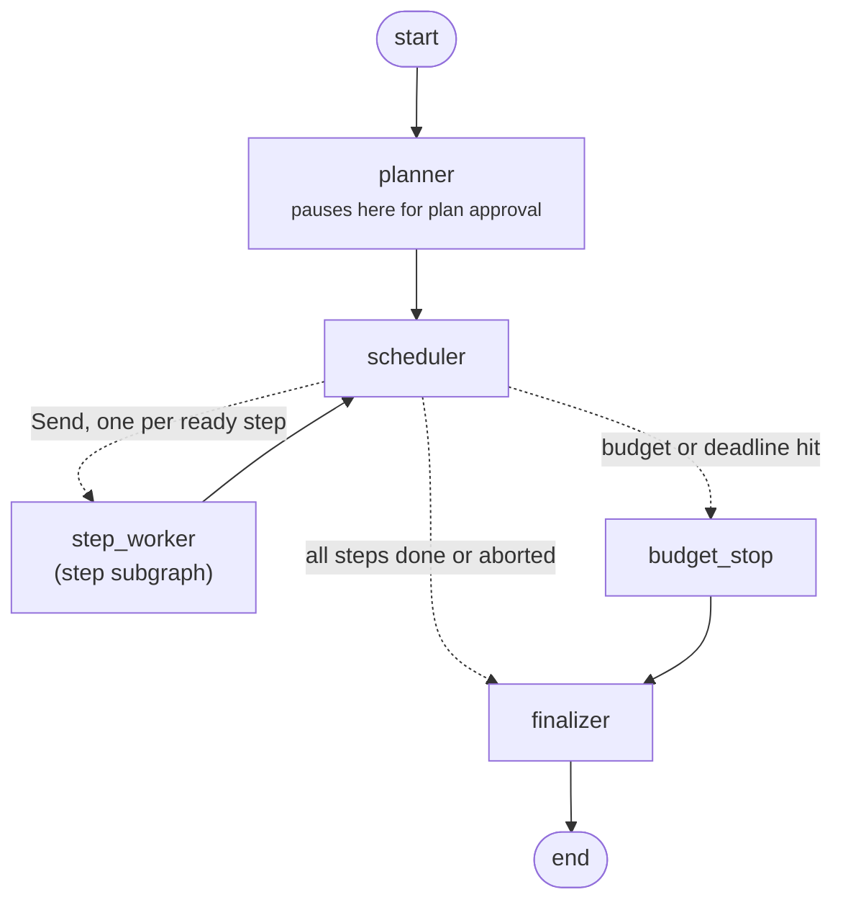
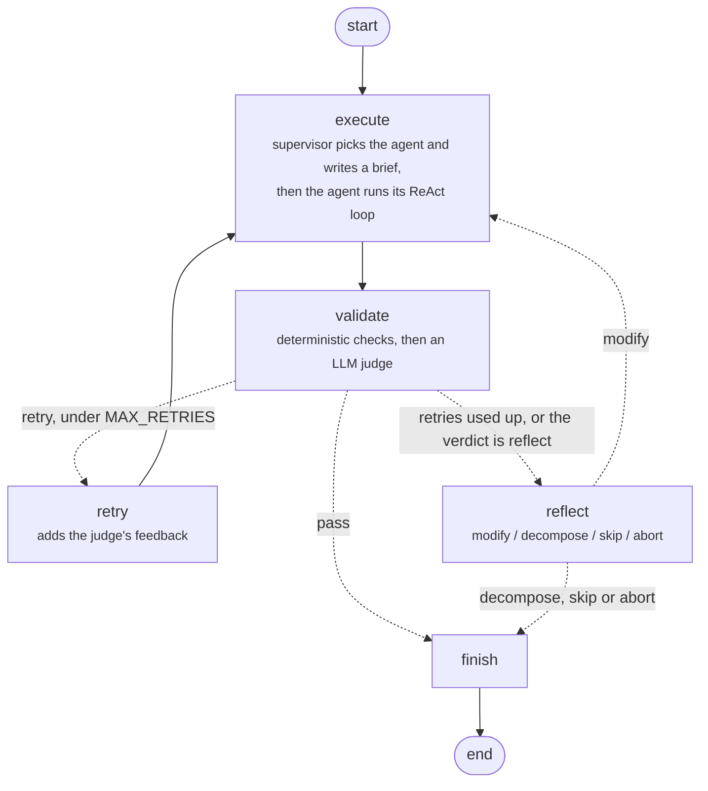

# Reliable AI Agent

A multi-step, multi-agent task runner built on **LangGraph** that keeps working when models fail. A planner splits a task into a dependency graph of steps. A supervisor hands each step to a specialist agent (research, code, analysis, writing) that runs a ReAct loop with its own tools. Every answer is validated, and failing steps are retried with the reviewer's feedback or repaired by a reflector. Model calls go through retries, a fallback chain of models and per-model circuit breakers. Run state is checkpointed after every wave of steps, so an interrupted run resumes where it stopped.

**What is measured, and how:**
- **98 deterministic unit tests** run against a scripted fake model: no network, no Redis, no keys.
- **A mutation check** injects 14 bugs into the core logic, and the tests catch 14 of 14 ([details and history](docs/mutation-results.md)).
- **A reproducible eval** runs 1,080 times on a *simulated* model with injected faults ([report](backend/eval/results/simulated.md)). It measures recovery, not answer quality.
- **A live eval on Amazon Bedrock** compares the full system with a single model call on 40 tasks, AI-graded. The first version lost clearly; after the fixes it found, the two tie on quality and the full system costs about 3x ([below](#live-eval-amazon-bedrock)).

## Live demo

- **UI:** https://reliable-agent.pages.dev (Cloudflare Pages)
- **API:** https://3-109-36-90.sslip.io (`/docs` for the API reference)

The backend runs on AWS EC2 (`t4g.micro`, Mumbai) and calls Amazon Bedrock with the instance's IAM role. The app turns the role's credentials into a short-term Bedrock key and refreshes it, so no API key is stored anywhere. Setup and cost are in [deploy/aws-ec2](deploy/aws-ec2/README.md). A full task costs about $0.003–0.005 in model tokens.

## How it works



Each `step_worker` runs this subgraph:



Both diagrams match the compiled graphs (`build_graph(...).get_graph().draw_mermaid()`).

| Concern | How it is handled | Where |
|---|---|---|
| Parallel steps | The scheduler sends every step whose dependencies have finished, through LangGraph `Send` (one per wave when `PARALLEL_MODE=false`). Reducers merge the logs of concurrent steps. | `agent/graph.py`, `agent/state.py` |
| Resume | The LangGraph checkpointer saves state after every super-step (thread = task id). A crashed run re-runs only the steps that had not finished. Backends: memory, SQLite, or Postgres (for example free Neon). | `agent/checkpointing.py` |
| Human in the loop | The run pauses after planning. `POST /tasks` returns the plan, and `POST /tasks/{id}/execute` approves it and continues. | `interrupt_after=["planner"]` |
| Multi-agent | The supervisor model picks the specialist and writes its brief, with deterministic rules as fallback. Workers run a text-protocol ReAct loop with only the tools their role allows and the deployment can run. Observations invented by the model are discarded. | `agent/multi_agent/` |
| Validation | Checks run in order: empty output, too short, cut off by the token limit (`finish_reason=length`), then the LLM judge. The verdict comes from the judge's scores, not from the verdict it states. | `agent/nodes/validator.py`, `agent/step_graph.py` |
| Provider failures | Errors are classified: 4xx fails fast, while 5xx, 429, timeouts and empty bodies are retried with backoff and jitter. Then the next model in `MODEL_CHAIN` is tried. Every role goes through this layer: planner, supervisor, workers, judge, reflector, finalizer. | `agent/reliability/` |
| Runaway cost | Each task has a token budget and a deadline. When either is hit, the run stops and reports partial results. | `TASK_TOKEN_BUDGET`, `TASK_DEADLINE_SECONDS` |
| Prompt injection via tools | Tool output is fenced as untrusted data. A failed tool is reported to the model as missing data ("do not invent"). | `agent/tools/dispatch.py` |

## Observability

- **Every model call is recorded**: node, step, model, input/output tokens as reported by the provider, latency and success. The final summary and `GET /metrics/{task_id}` derive these numbers from those records:
  - tokens in/out
  - latency p50/p95
  - output tokens per second
  - failed calls
  - fallbacks and same-model retries
  - a breakdown by node and by model
- **Cost** is reported only when every model used has a price in `MODEL_PRICES`. Otherwise it is left empty instead of being estimated.
- **OpenTelemetry spans** cover task, graph node, step, agent, model call (GenAI conventions such as `gen_ai.usage.input_tokens`) and tool call. They are exported over OTLP/HTTP when `OTEL_EXPORTER_OTLP_ENDPOINT` is set, for example to a local Jaeger or a hosted OTLP endpoint.
- **Live events** go to a per-task Redis Stream, so a browser that connects late or reconnects replays what it missed. Without Redis, an in-memory log behaves the same way.

## Eval (simulated provider)

`cd backend && python -m eval.run --seeds 1 2 3` runs 40 tasks × 3 systems × 3 fault profiles × 3 seeds. It takes about 15 s on a laptop and needs no network. The same seed gives the same records.

| Profile | naive (one call) | retry_only (graph, one model, no breaker, no reflection) | full |
|---|---|---|---|
| clean (20% of answers low quality) | 75.8% good | 95.8% good | 100.0% good |
| chaos (app's chaos middleware + the 20%) | 36.7% good | 58.3% good | 98.3% good |
| outage (primary model always 503) | 0% answered | 0% answered | 100.0% good |

"Good" means every delivered part passes the simulator's ground truth. The intervals, call counts and token counts are in the [report](backend/eval/results/simulated.md), and every run's raw record is in `simulated.jsonl`. **These are properties of the simulator**: it picks the failure rates, its judge is perfect, and reflection gets no built-in advantage beyond an extra attempt. The numbers show that the mechanisms work as designed and how the three systems compare. They say nothing about real-world reliability or answer quality. The full system spends about 13–23 model calls per task where naive spends one.

## Live eval (Amazon Bedrock)

`python -m eval.run --live --bedrock` runs the same 40 tasks on real models in `ap-south-1`. All models are in-Region and on demand: `gpt-oss-120b` is primary, `qwen3-32b` is the fallback, and `gpt-oss-20b` is the judge. The comparison is the full system against `naive`, a single call to the primary model. `python -m eval.grade` then scores each answer against its task rubric with `qwen3-32b`, a different model from the one that wrote the answers. **These scores are AI-graded, not human-reviewed.** Re-grading the same naive answers moved coverage by 0.8 points (95% CI 0.0–2.5), which gives a sense of the grader's noise.

| Run | Rubric coverage, naive | Rubric coverage, full | Full − naive, paired (95% CI) | Cost per task, naive / full | Time per task, naive / full |
|---|---|---|---|---|---|
| v1 | 90.0% | 73.3% | **−16.7 pp (−27.5 to −5.8)** | $0.0014 / $0.0148 | 6 s / 52 s |
| v2 | 90.8% | 94.2% | +3.3 pp (−1.7 to +8.3) | $0.0014 / $0.0042 | 6 s / 13 s |

**v1 lost, and the losses were bugs:**
- The planner split even short writing tasks into 6–10 steps, including "research" steps when no search tool existed. The judge rejected those steps, which caused 55 retries and 59 reflection visits.
- The finalizer passed only the first 500 characters of each step to the synthesis prompt, so most of the agents' work never reached the final answer.
- Three plans failed outright.

**v2** applies the fixes:
- The planner is asked for the fewest steps (1–6) and is told when no web search exists.
- Single-step plans are allowed.
- The synthesis prompt receives 3,000 characters per step and is told to write the deliverable itself.

With those fixes, all 40 tasks completed, with an average of 1.55 steps. Per task, the full system won 7, tied 30 and lost 3 against naive. The quality difference is within noise.

**Reading:** with a capable model and no injected faults, the multi-agent machinery adds cost and time without a measurable quality gain. The simulated eval above shows where it pays off: provider failures and outages.

Things the live run also found and fixed:
- gpt-oss returns its reasoning inline as `<reasoning>…</reasoning>`. This is now stripped.
- Bedrock's JSON-object mode returns a doubled opening brace. JSON is now extracted from plain text instead.
- Planner JSON broke under JSON-object mode, because the planner asks for an array.
- Several token limits were too small for reasoning models.
- `LLM_REASONING_EFFORT=low` roughly halved gpt-oss output tokens in one check.

Raw records and reports: `backend/eval/results/live-v1*` and `live-v2*`. Total model spend for both runs, pilots and grading was about $1.1 by the recorded token counts. AWS Billing is the authority.

## Run it

```bash
# backend
cd backend
python -m venv .venv && source .venv/bin/activate
pip install -r requirements-dev.txt
cp .env.example .env          # set a model endpoint, see below
uvicorn main:app --reload     # http://localhost:8000/docs

# checks
ruff check . && python -m pytest -q
python -m eval.run --limit 5
python scripts/mutation_check.py

# frontend
cd ../frontend && npm ci && npm run dev   # http://localhost:5173
```

**Models.** Any OpenAI-compatible endpoint works. Set `OPEN_SOURCE_BASE_URL`, `OPEN_SOURCE_API_KEY` and `MODEL_CHAIN` (comma-separated, tried in order). The Hugging Face router, the Gemini API's OpenAI-compatible endpoint, Groq and a local Ollama all fit. Free tiers change, so check the provider. If an endpoint rejects explicit temperatures, set `LLM_SEND_TEMPERATURE=false`.

**Optional:**
- `TAVILY_API_KEY` enables web search for the research agent.
- `CHECKPOINT_URL=postgresql://...` makes resume survive restarts.
- `docker compose up --build` runs Redis, the backend and the frontend together.

## API

| Method | Endpoint | Purpose |
|---|---|---|
| `POST` | `/tasks` | Plan a task. The run pauses and the response has the steps |
| `POST` | `/tasks/{id}/execute` | Approve the plan and run (`already_running` if a run is active) |
| `POST` | `/tasks/{id}/resume` | Continue an interrupted run from its last checkpoint |
| `GET` | `/tasks/{id}` | Full saved state |
| `GET` | `/traces/{id}`, `/traces/{id}/summary` | Trace events |
| `GET` | `/metrics/{id}`, `/metrics`, `/metrics/providers` | Task LLM usage, aggregates, circuit states |
| `GET` | `/config` | Runtime settings and the active model chain |
| `POST` | `/config*` | Change settings. Needs `X-Admin-Key`, and is refused when `ADMIN_API_KEY` is unset |
| `WS` | `/ws/{id}` | Live events, replayed from the start |

## Security defaults

Two tools act on the server's behalf, so both are **off unless an operator enables them**:

| Switch | Default | What it allows | Guard when enabled |
|---|---|---|---|
| `ENABLE_CODE_EXEC` | `false` | The code agent runs Python | The child process gets an empty environment (no API keys), isolated mode, a temp dir, CPU/file/process limits and truncated output. **Network is not blocked: this is not a sandbox.** |
| `ENABLE_API_CALL` | `false` | The research agent fetches URLs | http(s) only, and every resolved address must be public (blocks loopback, private and cloud-metadata ranges). Redirects are not followed. DNS rebinding is not covered. |

Endpoints that change process-wide settings need `X-Admin-Key`, so a public deployment is read-only. To change settings from the UI, store the key in the browser with `localStorage.setItem("agent_admin_key", "...")`.

## Limits

- **The live eval is AI-graded** by one model on 40 tasks with three rubric points each. It is a comparison between systems, not a human-validated quality score. The v2 fixes were made after seeing v1 on the same tasks, so v2 is not an independent held-out result.
- **The demo runs on one small instance**: a `t4g.micro` in `ap-south-1`, with in-memory circuit breakers and SQLite checkpoints. It is limited to 5 tasks per IP per hour and 50 per day, and an AWS Budget alert fires at $5. It is a demo, not a production deployment.
- **Python execution is not sandboxed**: there is no network isolation. Keep `ENABLE_CODE_EXEC=false` anywhere untrusted users can submit tasks.
- **Resume granularity is one step.** A step that was running when the process died runs again from its start. Its model calls are not idempotent, so they are repeated (and paid for again).
- **The in-memory checkpointer** (the default) loses runs on restart. Use SQLite or Postgres to resume across restarts.
- **The circuit breaker state is per process.** Several workers or instances do not share it.
- The simulated eval's numbers depend on the simulator's design, as stated above.

## Project layout

```
backend/
  agent/graph.py            planner -> scheduler -> Send(step_worker) -> finalizer, runtime helpers
  agent/step_graph.py       per-step subgraph: execute -> validate -> retry | reflect -> finish
  agent/state.py            graph state and reducers
  agent/multi_agent/        supervisor, ReAct worker, agent definitions
  agent/nodes/              planner, judge, reflector, finalizer
  agent/reliability/        retry, fallback chain, circuit breaker, chaos injection
  agent/tools/              web search, HTTP GET, Python; URL guard, untrusted-output fencing
  services/                 LLM client, usage records, LLM metrics, Redis streams
  eval/                     tasks, simulator, runner, report, results
  scripts/mutation_check.py
  tests/unit/               98 tests with a scripted fake model
frontend/                   React + Vite dashboard
```

## License

MIT, see [LICENSE](LICENSE).
